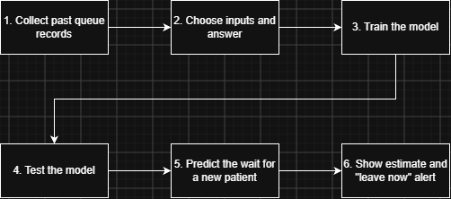

# Technology Brief: Machine Learning

## C1. Fundamental Concepts

### What is machine learning?

Machine learning (ML) is a way for a computer to learn from past data instead of following fixed rules that a programmer writes. The computer finds patterns in the data and uses those patterns to make predictions on new data. This project uses **supervised learning**, which means the training data includes the correct answers (the real waiting times) so the model can learn from them.

### Key Concepts

### How it works at a basic level

The figure below shows the four main steps of a machine learning pipeline for this project.

*Figure 1. Full machine learning pipeline — from collecting queue records to showing the waiting time estimate and "leave now" alert to the patient (made by the author).*

### Worked example (made-up data)

| Patients ahead | Service type | Hour | Real wait (min) |
|---|---|---|---|
| 2 | Follow-up | 9 am | 12 |
| 5 | Check-up | 10 am | 40 |
| 3 | Check-up | 11 am | 26 |
| 6 | Follow-up | 2 pm | 35 |
| 1 | Check-up | 3 pm | 10 |

A new patient has 4 patients ahead, for a check-up at 10 am. A simple average gives about 29 minutes (123 minutes ÷ 17 patients × 4). The model learns that check-ups take longer than follow-ups, so it may predict about 34 minutes — a more accurate estimate.

---

## C2. Frameworks, Models, Methods and Tools

| # | Item | Type | What it is used for in this project |
|---|---|---|---|
| 1 | Linear regression | Baseline model | A simple starting model to compare with better models. It shows how much improvement the main model gives. |
| 2 | Random forest (Breiman, 2001) | Main model | Averages the predictions of many decision trees. It handles busy hours and different service types better than a single tree. |
| 3 | scikit-learn (Pedregosa et al., 2011) | Python library | Trains, tests, and saves the model. It has ready-made functions for random forest, linear regression, and MAE. |
| 4 | Mean Absolute Error (MAE) | Evaluation metric | Measures how far the prediction is from the real waiting time, in minutes. Used to check if NFR5 is met. |
| 5 | Pandas | Data library | Loads and cleans the queue records (CSV files) before they go into the model. |

---

## C3. Fit to the Problem

### How machine learning addresses the problem

The core problem is that patients do not know their waiting time, so they sit inside the clinic the whole time. A machine learning model estimates the waiting time from past queue records. The CMS shows this estimate on the patient's phone (FR4) and uses it to trigger a "leave now" alert (FR5) when the patient's turn is close. This lets patients wait outside the crowded room.

Machine learning is a good fit because waiting time depends on more than one factor — the number of patients ahead, the service type, and the time of day all affect how long the wait will be. A simple average cannot account for all these factors at once.

### Benefits

- The estimate is more realistic than one fixed average, because it learns from the clinic's real pattern.
- It directly supports the alert system (FR5), which helps patients wait outside and reduces crowding.
- It uses only queue timing data, so the clinic does not need extra hardware or sensors.
- The model can improve over time as more data is collected.

### Limitations and risks

| Limitation | Detail |
|---|---|
| Data need | A new clinic has little historical data at first. The estimate will be weak until enough records are collected. The simple formula (see alternative below) can be used in the meantime. |
| Privacy | Timing data is linked to patient visits. Health data is sensitive and must be handled under PDPA 2010 Malaysia (Abdul Manap et al., 2024). Only timing data should be stored — no names or diagnosis. |
| Changes over time | Waiting time patterns change when doctors, clinic hours, or busy seasons change. The model needs to be retrained regularly. |
| Wrong estimate | If the estimate is too low, a patient may miss their turn. The alert should use a small safety buffer (for example, alert when 4 patients remain instead of 3). |

### Comparison with one alternative: simple formula

| Aspect | Machine learning (chosen) | Simple formula |
|---|---|---|
| How it works | Learns from past records to predict waiting time | Patients ahead × average time per patient |
| Accuracy | Better — accounts for service type and time of day | Lower — treats every patient the same |
| Data needed | Needs historical queue records to train | No training data needed |
| Cost and effort | Higher — needs a model and regular retraining | Very low — one calculation |
| Fit to this project | Strong after enough data is collected | Acceptable for a new clinic with little data |

### My choice and reason

I would choose machine learning because waiting time at a clinic depends on the type of service and the time of day. A simple formula cannot adjust for these differences. However, I would start with the simple formula while the clinic is new and has little data, then switch to the machine learning model once enough records are available. This gives the clinic a working system from day one.
